 

## ✨ Sobre mim

Sou estudante de **Desenvolvimento de Sistemas**, em formação técnica integrada ao **Ensino Médio**, com interesse em **tecnologia, desenvolvimento de software e análise de dados**.

Gosto de entender como a tecnologia pode resolver problemas reais, otimizar processos e transformar informação em soluções estratégicas. Para isso, uno **raciocínio lógico**, **pensamento analítico** e uma visão voltada à resolução de problemas, sempre com postura de **aprendizado contínuo** e vontade de transformar teoria em prática.

## 🔭 Em foco

- 💻 Construção de **sistemas e aplicações** (web e mobile)
- 📊 **Análise e interpretação de dados**
- 🚀 Buscando oportunidades para **ampliar minha experiência** e contribuir com projetos de **inovação, software e dados**

## 🌌 Minhas skills

| | Tecnologias |
|:---|:---|
| **Front-end** |  |
| **Back-end** |  |
| **Mobile** |  |
| **Banco de dados** |  |
| **Design & ferramentas** |  |

*"Para tudo há um tempo, um jeito e um propósito"* ⭐

